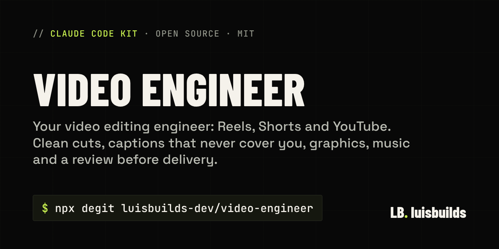

<p align="center"></p>

<h1 align="center">Video Engineer</h1>

<p align="center"><b>Tu ingeniero de edición de vídeo para Claude Code: Reels, TikTok, Shorts y YouTube.</b><br>
Grabas. Él limpia el crudo, subtitula sin taparte, añade gráficos, efectos y música, renderiza con Remotion y revisa el resultado antes de entregártelo.</p>

<p align="center">
  
  
  
  
</p>

<p align="center"><a href="README.md">🇬🇧 English</a> · <a href="https://luisbuilds.com/h/video-engineer">Guía paso a paso</a></p>

---

## Qué hace

1. **Transcribe** tu crudo palabra a palabra con Whisper, en tu equipo y sin internet.
2. **Limpia**: te propone el texto sin tomas repetidas, muletillas ni pausas largas. **Tú lo apruebas** antes de cortar nada.
3. **Edita**: gancho en los primeros segundos, subtítulos palabra a palabra, tarjetas, gráficos, ilustraciones, efectos de sonido y música. Claude decide; Remotion dibuja.
4. **Renderiza** en vertical (1080×1920) u horizontal (1920×1080), color bt709 y volumen a -14 LUFS (el de Instagram, TikTok y YouTube).
5. **Revisa** volumen, planos congelados, negros, legibilidad y datos personales a la vista **antes** de entregarte nada.

Tu grabación original nunca se toca: se trabaja sobre una copia, y un hook bloquea cualquier intento de borrarla o sobrescribirla.

## Inicio rápido

Necesitas **Node.js 20+**, **ffmpeg** y **Claude Code**. El doctor te dice qué falta y cómo instalarlo.

```bash
git clone https://github.com/luisbuilds-dev/video-engineer.git
cd video-engineer
npm ci
claude
```

Dentro de Claude Code escribe **`/empezar`**. Revisa tu equipo, instala lo que falte con tu permiso y te hace un cuestionario corto para crear tu estilo.

## Qué incluye

- **Subtítulos que nunca te tapan**: analiza cada fotograma (cara y movimiento) y coloca cada subtítulo, tarjeta y gráfico donde no tapa nada, sin saltos.
- **Encuadre inteligente**: graba en vertical y publica en YouTube (o al revés). El encuadre sigue tu cara para que siempre se vea completa, con relleno desenfocado a los lados si hace falta.
- **Gráficos animados**: cifras que cuentan, barras comparadas, listas que se marcan al decirlas y sellos.
- **Ilustraciones de lo que dices**: más de 2.000 iconos que se dibujan solos y escenas animadas (proceso con flechas, caos → orden, antes / después, piezas que encajan). ¿Falta un icono? Lo busca en Iconify (solo licencias libres) y lo guarda con su crédito.
- **Logos reales** de más de 3.000 marcas (en su color, con halo) y **diagramas** que se dibujan al decirlos (flujo, radial o árbol).
- **Cabecera**: barra de secciones que se llena como un cronómetro y una onda que se mueve con tu voz.
- **Grabaciones de pantalla** con zooms suaves a lo que nombras, mientras tú apareces en una burbuja.
- **Tus datos, a salvo**: un OCR local encuentra en tus grabaciones de pantalla correos, teléfonos, cédulas, tarjetas, cuentas, claves de API, IPs, contraseñas y las frases que marques como privadas. **Te pregunta** antes de difuminarlas, el difuminado sigue el desplazamiento y los zooms, y el vídeo final se vuelve a leer: si algo se lee, no se entrega.
- **14 efectos de sonido originales** y **10 efectos de cámara**, colocados solos según tu estilo y siempre por debajo de tu voz.
- **24 pistas de música** de Kevin MacLeod (CC BY 4.0): elige la parte con más energía, la baja mientras hablas y te deja el crédito para el post.
- **Capítulos de YouTube** con tarjeta de transición y las marcas de tiempo listas para la descripción.
- **13 tipografías**, tus propios estilos y una **guía que aprende de cada vídeo** lo que te gusta.
- **Consejos de viralidad**: puntuación de retención con 8 señales, qué mejorar, y el texto y los hashtags del post.

## Comandos

| En Claude Code | Para qué |
|---|---|
| `/empezar` | Primera vez: revisa la instalación y te configura |
| `/limpiar` | Un crudo nuevo: transcribe, te propone el texto limpio y corta |
| `/editar` | Gancho, gráficos, render y revisión |
| `/revisar` | Vuelve a revisar un render |
| `/estilo` | Tu propio estilo: fuentes, colores, subtítulos, ritmo, efectos |
| `/consejos` | Puntuación de retención, qué mejorar y textos para el post |
| `/aprender` | Actualiza tu guía de estilo tras cada vídeo entregado |
| `/ampliar` | Pide algo que el kit aún no sabe hacer: lo investiga, lo construye con pruebas y lo añade |

Los scripts también funcionan solos: `npm run doctor`, `transcribir`, `cortar`, `analizar`, `componer`, `render`, `revisar`.

## Por qué gasta pocos tokens

- Las cuentas (tiempos, cortes, volumen, colocación, OCR) las hacen scripts, no el modelo.
- Para revisar, Claude **no ve el vídeo**: mira una sola imagen con 12 fotogramas y un informe de números.

## Requisitos

| | Windows | macOS | Linux |
|---|---|---|---|
| Node.js 20+ | [nodejs.org](https://nodejs.org) | [nodejs.org](https://nodejs.org) | gestor de paquetes |
| ffmpeg | `winget install Gyan.FFmpeg` | `brew install ffmpeg` | `sudo apt install ffmpeg` |
| Para compilar whisper.cpp | — | `xcode-select --install` | `sudo apt install build-essential git` |

Whisper (~466 MB con el modelo `small`) se instala dentro de la carpeta del proyecto con `npm run instalar -- --si`.

## Preguntas frecuentes

**¿Mis vídeos salen de mi computadora?**
No. La transcripción, los cortes, el OCR y el render ocurren en tu equipo. Claude solo lee el texto transcrito y una imagen de control.

**¿En qué idiomas funciona?**
En cualquiera que entienda Whisper. Si tienes acento marcado o ruido, el modelo `medium` acierta más.

**¿Tengo que pagar algo?**
El kit es gratis y de código abierto. Necesitas Claude Code con tu cuenta. Remotion es gratis para personas y empresas de hasta 3 personas; si tu empresa es más grande, revisa su [licencia](https://www.remotion.dev/license).

## Soporte

Se publica **tal cual**, gratis y sin soporte garantizado. Si encuentras un problema de seguridad, avísame en privado (ver [SECURITY.md](SECURITY.md)).

---

<p align="center">Hecho por <a href="https://luisbuilds.com">Luis Cabrera</a> · <a href="LICENSE">Licencia MIT</a> · Construido sobre <a href="https://www.remotion.dev">Remotion</a> y <a href="https://github.com/ggml-org/whisper.cpp">whisper.cpp</a> · <a href="NOTICE.md">Avisos de terceros</a></p>
